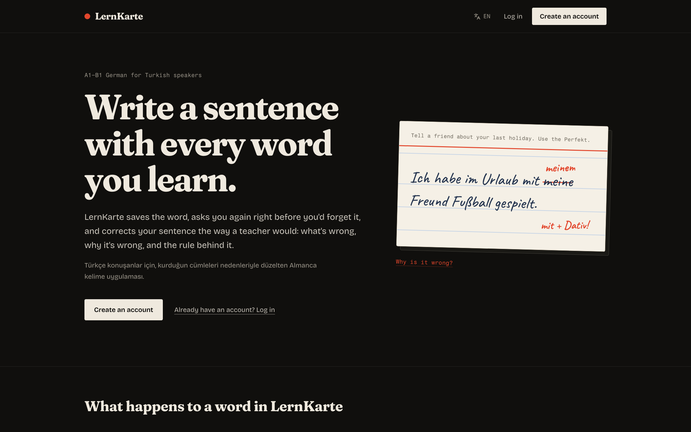
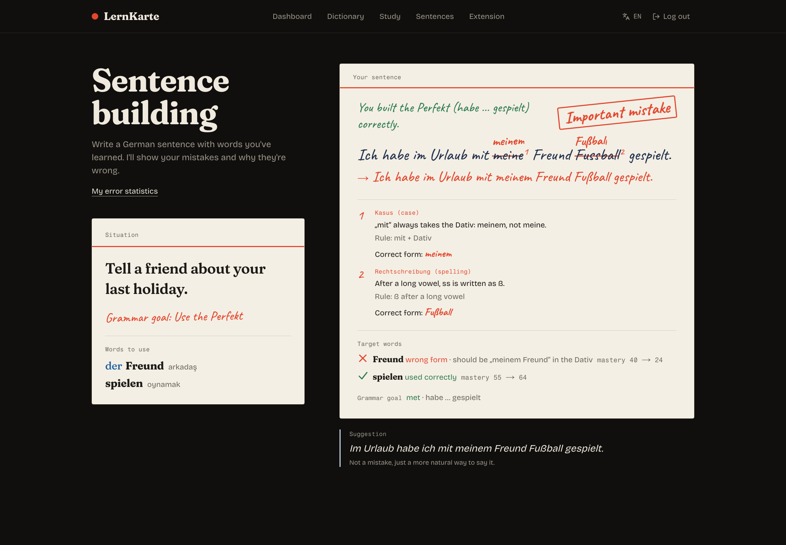
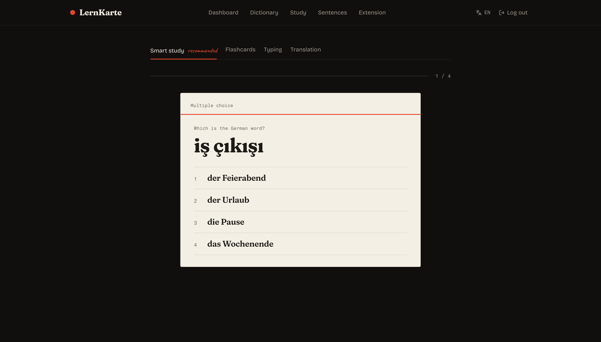
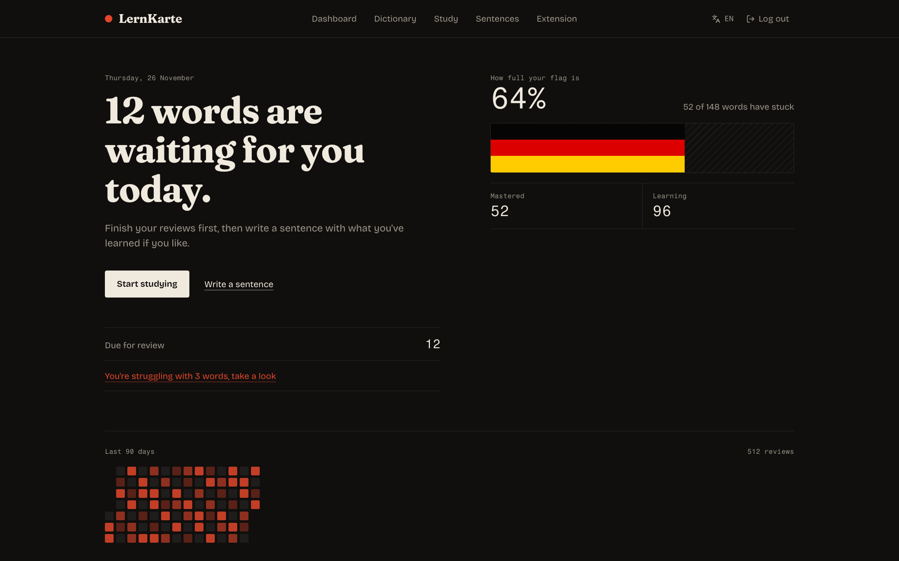

# LernKarte



LernKarte is a German vocabulary trainer for Turkish speakers (A1–B1). You add
words, it fills in the details and schedules your reviews, and when you write
your own sentences with those words, Claude corrects them the way a teacher
would: where the mistake is, why it's wrong, and the rule behind it.

**Live:** https://lernkartee.vercel.app

## Features

### Sentence building ("Cümle Kur")



- The app picks words to practise: due reviews first, then recently learned
  ones. A task starts with one word and grows to two or three as you write
  good sentences in a row, then drops back after a serious mistake.
- Each task comes with a situation ("Tell a friend about your last holiday")
  and sometimes a grammar goal matched to your level (Perfekt, Dativ,
  a *weil* clause…). Tasks are built locally, so only the evaluation costs an
  API call.
- Claude returns structured JSON (validated against a schema, re-requested
  once if malformed): a verdict, what you did right, each error located in
  your sentence with its type (Artikel, Kasus, Konjugation, Wortstellung,
  Rechtschreibung, Wortwahl), the reason and the rule, whether each target
  word was used correctly, and a separate style suggestion.
- The prompt and a server-side consistency check stop it from inventing
  errors: a sentence with no listed errors is always "correct", and style
  tips are never shown as errors.
- You get one more try before the correction is shown. The first try feeds
  the review schedule: a word used correctly gets stronger, a misused one
  comes back sooner.
- A statistics page shows your most frequent error types and how they change
  week by week.

### Spaced repetition



- Every word has a mastery score (0–100) and an SM-2-style interval. Harder
  question types earn more mastery; slow answers earn less.
- The question type follows mastery: multiple choice for new words, then
  fill-in-the-gap, typing, and free translation (graded by Claude for
  meaning, not exact wording).
- Words you keep getting wrong are flagged and come first.
- If grading fails, the answer is not counted as wrong.

### Enrichment

Type a word in German or Turkish. Claude resolves it to a German lemma
("araba" becomes *das Auto*) and adds article, plural, pronunciation,
meanings, a usage note and an example sentence. Input it can't identify is
flagged for review instead of being filled with invented data.

### Progress



The German flag fills with your average mastery, and a 13-week calendar
shows your study days (counted in Turkish time).

### Also

- **Chrome extension:** select a word on any page and add it together with
  the sentence it appeared in (see below).
- **Interface in Turkish, English and German**, following the browser
  language until you pick one.

## Tech stack

- **Next.js 16** (App Router, Server Components, Server Actions), **React 19**, **TypeScript**
- **Tailwind CSS 4**
- **Supabase**: Postgres, Auth, Row Level Security on every table
- **Claude API** (`claude-sonnet-4-6`) via the Anthropic SDK, with structured outputs and prompt caching
- **Vitest** for unit tests
- **Vercel**, deployed in the same region as the database
- Chrome extension: Manifest V3, built with esbuild

A few implementation notes:

- The Anthropic API key and the Supabase service-role key exist only on the
  server; the browser and the extension use the public anon key, and Row
  Level Security keeps each user's data private.
- Sessions are verified locally from the token signature instead of a round
  trip to Supabase Auth on every request.
- Learning logic (scheduling, task selection, error statistics, answer
  matching) is plain TypeScript in `lib/` and covered by tests.

## Running locally

You need Node.js 20+, a Supabase project and an Anthropic API key.

```bash
git clone https://github.com/CybTT/lernkarte.git
cd lernkarte
npm install
cp .env.example .env.local   # then fill in the four values
```

1. In the Supabase SQL editor, run `supabase/schema.sql`. (Existing projects:
   run the files in `supabase/migrations/` in order instead.)
2. Optionally load the A1–B1 word pool used for multiple-choice options:

   ```bash
   npx tsx scripts/seed-dictionary-pool.ts
   ```

3. Start the app and the tests:

   ```bash
   npm run dev
   ```

   ```bash
   npm test
   ```

Open http://localhost:3000.

## Chrome extension (manual install)

The extension lets you select a German word on any web page and add it to
your dictionary with a right-click (or `Ctrl+Shift+E` / `Cmd+Shift+E`). It
isn't on the Chrome Web Store, so install it by hand:

1. Download this repository (**Code → Download ZIP**) and unzip it.
2. In Chrome, open `chrome://extensions`.
3. Turn on **Developer mode** (top right).
4. Click **Load unpacked** and choose the `extension` folder.
5. Click the LernKarte icon in the toolbar, choose **Giriş yap** (log in), and
   sign in on lernkartee.vercel.app. The extension connects to your account
   automatically.

The built files in `extension/dist` are committed, so no build step is needed.
After changing the extension source, rebuild it:

```bash
cd extension && npm install && npm run build
```

## License

[MIT](LICENSE)
